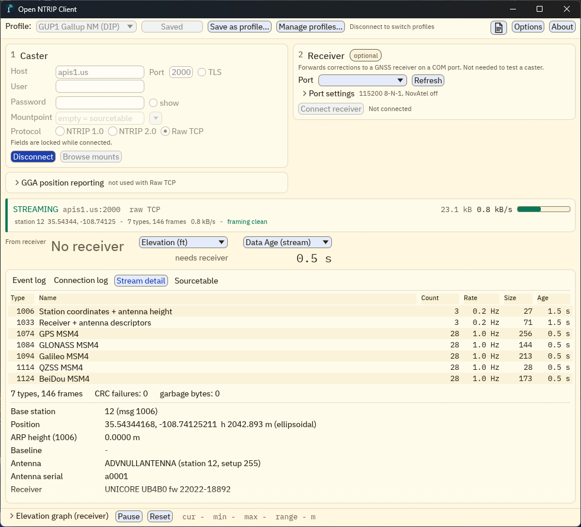
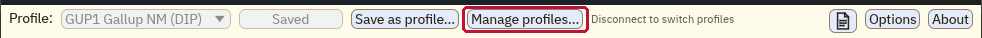
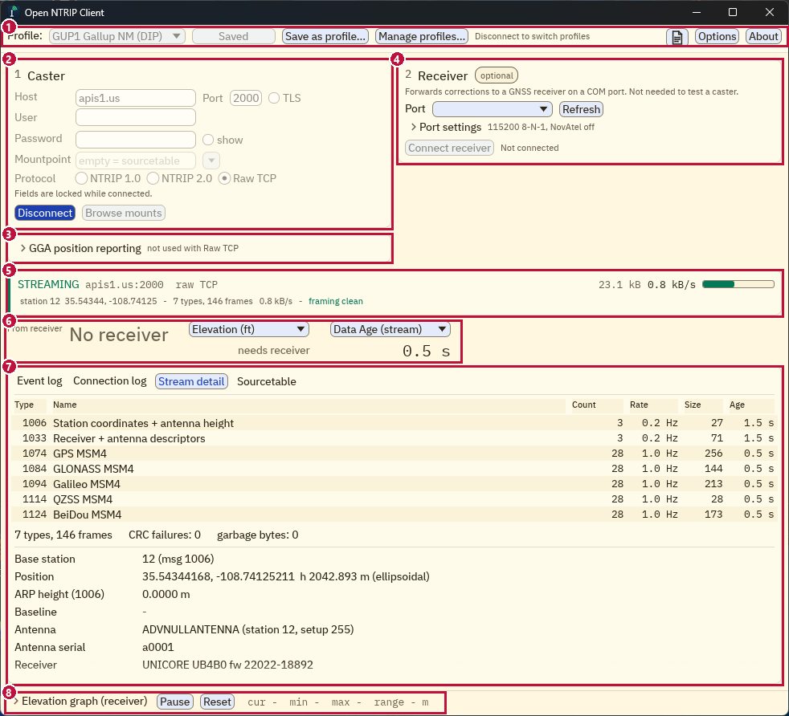
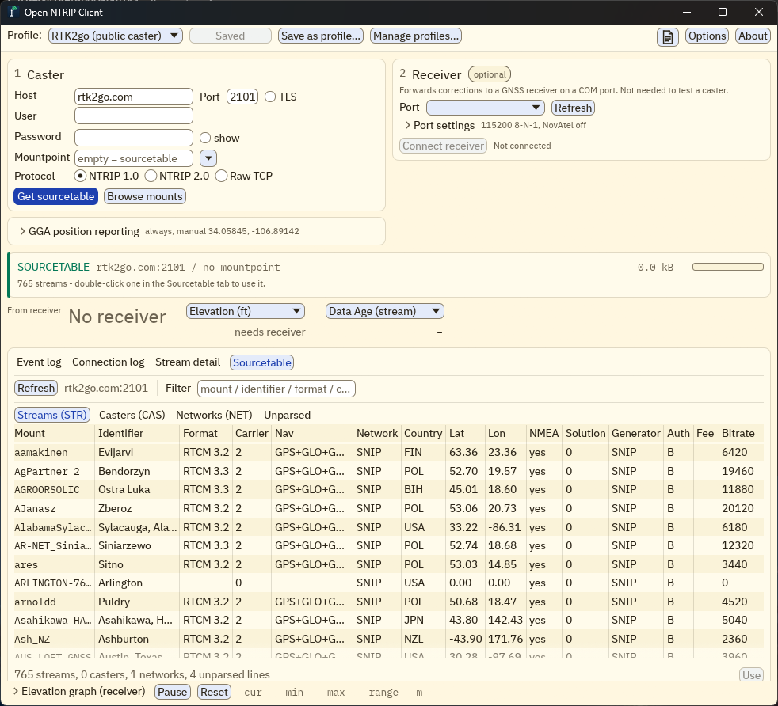
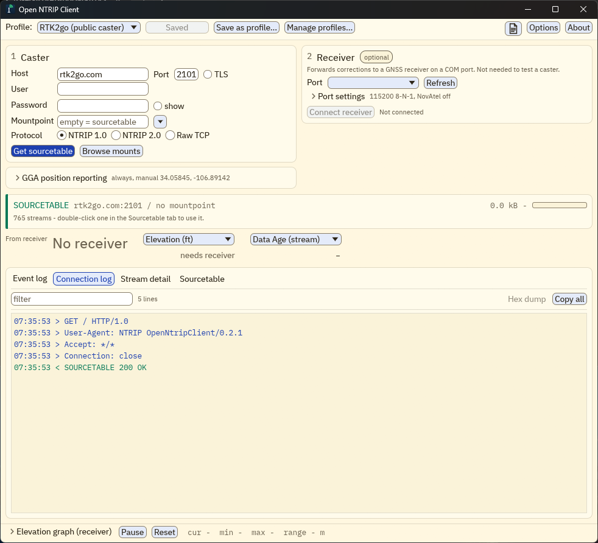
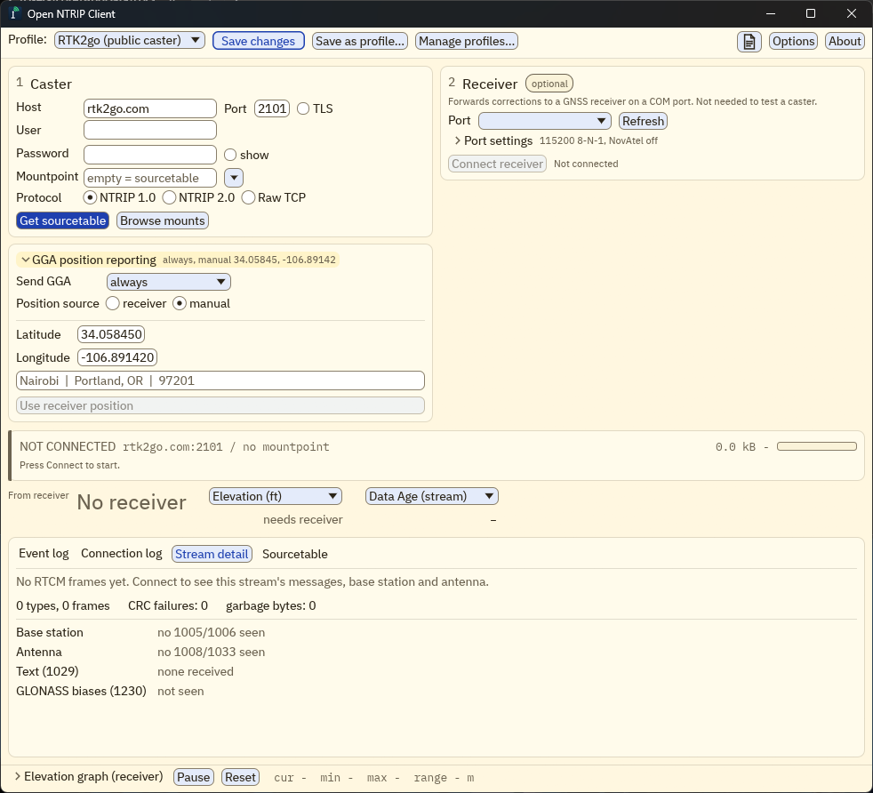
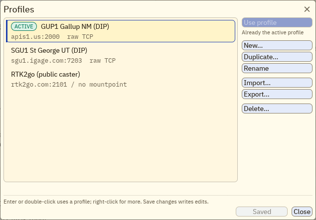
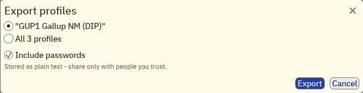
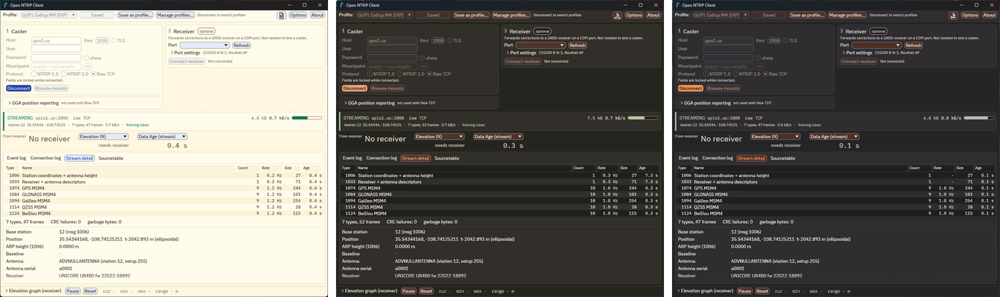

# Open NTRIP Client

[](https://github.com/intnsity/OpenNTRIPClient/actions/workflows/ci.yml)
[](https://github.com/intnsity/OpenNTRIPClient/releases)
[](LICENSE)

A free, open-source diagnostic client for NTRIP / RTK correction streams. One portable
executable, no installer: drop it in a folder, connect to a caster, and see exactly what is
happening on the wire - credentials, mountpoints, sourcetables, RTCM message flow, and the
NMEA position handshake.



A clean-room successor to the [Lefebure NTRIP Client](https://lefebure.com/software/ntripclient/),
rebuilt in Rust for Windows, Linux and macOS. **Status: 0.3.0, pre-release (pre-1.0).**

**Contents:** [Download and run](#download-and-run) -
[Change it yourself](#change-it-yourself) - [A tour of the window](#a-tour-of-the-window) -
[When it does not work](#when-it-does-not-work) - [Features](#features) -
[Good to know](#good-to-know) - [Documentation](#documentation) - [License](#heritage-and-license)

## Download and run

Grab `OpenNtripClient.exe` from the **[releases page](https://github.com/intnsity/OpenNTRIPClient/releases)**
(Linux and macOS archives are there too). Put it in a folder of its own and run it. It keeps
its settings, logs and captures in that folder, and nowhere else.

1. In **1 Caster**, enter host, port, user and password. Click **Browse mounts**, pick a
   mountpoint, then click **Connect**.
2. Read the band under the cards: **STREAMING** in green means corrections are arriving.
   Anything else comes with the reason and the next step.
3. Happy with it? Click **Save as profile...** and give it a name.
4. Optional: in **2 Receiver**, pick your receiver's COM port to forward corrections to it.

If the caster wants your position (VRS or geofenced mounts), open **GGA position reporting**
and enter a nearby city, ZIP or lat/lon. Coming from the Lefebure client? Copy your old
`Settings.txt` and `ntripconfig.txt` into the folder before the first run, and they are
imported.

## Change it yourself

Every label, button and color is plain Rust in one folder, `crates/app/src/ui/`. You can
change a word, rebuild and see it in a couple of minutes.

### 1. Install the tools (once)

| | Windows | Linux (Debian/Ubuntu) | macOS |
|---|---|---|---|
| Git | `winget install Git.Git` | `sudo apt install git` | `xcode-select --install` |
| Rust | `winget install Rustlang.Rustup` | `curl https://sh.rustup.rs -sSf \| sh` | `curl https://sh.rustup.rs -sSf \| sh` |
| C/C++ build tools | Visual Studio Build Tools, "Desktop development with C++" (the Rust installer offers it) | `sudo apt install build-essential pkg-config libudev-dev libxkbcommon-dev libwayland-dev libgl1-mesa-dev` | included with `xcode-select` |

Nothing else is needed: the exact Rust version the project uses (`rust-toolchain.toml`)
downloads itself on the first build, and the build works offline after that. An editor with
Rust support helps; VS Code with the **rust-analyzer** extension is a good free choice.

### 2. Get the code and run it

```sh
git clone https://github.com/intnsity/OpenNTRIPClient.git
cd OpenNTRIPClient
cargo run --bin OpenNtripClient
```

The first build takes a few minutes. After that, a rebuild following a small edit takes
seconds. On Windows, `.\scripts\dev.ps1` does the same and keeps build files off network
shares.

### 3. Make a change: rename a button

Say **Manage profiles...** should read **Profiles...**.



Search for the text you see on screen:

```sh
git grep -n "Manage profiles..." crates
```
```
crates/app/src/ui/main_window.rs:867:            .button("Manage profiles...")
```

Open that file, change the string, save:

```rust
// before
.button("Manage profiles...")
// after
.button("Profiles...")
```

Run `cargo run --bin OpenNtripClient` again and the button has its new name.

Colors work the same way. They all live in `crates/app/src/ui/theme.rs`, one block per theme:

```rust
pub const BUTTER_PAPER: Palette = Palette {
    name: "Butter Paper",
    paper_0: rgb(0xFAF3D9),     // window background
    ink_primary: rgb(0x2B2417), // main text
    accent: rgb(0x1E40AF),      // the blue of the main buttons
    // ...
};
```

### 4. Check it before you share it

```sh
cargo fmt --all
cargo clippy --workspace --all-targets -- -D warnings
cargo test --workspace
cargo build --release
```

These are the same checks CI runs (on Windows, `.\scripts\dev.ps1 -Check` runs all four). If
a test pinned the old wording, it fails and names the file, so update the expected text there
too. The finished program is `target/release/OpenNtripClient.exe` (no `.exe` on Linux or
macOS). To send a change back, fork the repo and open a pull request.

### Where things live

| On screen | File in `crates/app/src/ui/` |
|---|---|
| Profile bar (Save changes, Save as profile, appearance, Options, About) | `main_window.rs` |
| 1 Caster card | `ntrip_block.rs` |
| GGA position reporting | `gga_section.rs` |
| 2 Receiver card | `serial_block.rs` |
| Session band (STREAMING, rate, next step) | `session_band.rs` |
| Fix banner and readouts | `status_strip.rs` |
| Tabs: Event log, Connection log, Stream detail, Sourcetable | `log_pane.rs`, `connlog_window.rs`, `rtcm_inspector.rs`, `sourcetable_browser.rs` |
| Elevation graph | `plot_panel.rs` |
| Profiles, Export / Import, Options, About windows | `profiles_dialog.rs`, `profile_transfer.rs`, `options_dialog.rs`, `about.rs` |
| Colors, button styles, the three themes | `theme.rs` |

Below the UI, the code splits into four crates:

| Crate | What it does |
|---|---|
| `crates/app` | The window, settings, profiles, logging, and the network and serial worker threads |
| `crates/ntrip-core` | The NTRIP 1.0 / 2.0 / raw TCP protocol, TLS, sourcetable parsing |
| `crates/gnss` | RTCM3 framing and decoding, NMEA parsing |
| `crates/geodb` | The offline city / ZIP geocoder (data regenerated by `tools/geodb-gen`) |

Two rules the tests enforce: colors are named only in `theme.rs` (elsewhere use
`theme::accent()`, `theme::ink_secondary()` and so on), and number fields go through
`theme::number_field`.

## A tour of the window

The whole client is one window, read top to bottom: set up, then the verdict, then the
evidence.



| | Region | What it is for |
|---|---|---|
| 1 | **Profile bar** | Pick a saved profile, **Save changes**, **Save as profile...**, **Manage profiles...**, the theme icon, Options, About |
| 2 | **1 Caster** | Host, port, credentials, mountpoint and protocol (NTRIP 1.0, 2.0 or raw TCP). The one solid button says what it will do: Connect, Get sourcetable or Disconnect |
| 3 | **GGA position reporting** | The position sent to casters that ask for one: from your receiver, or a manual point found by city, ZIP or lat/lon |
| 4 | **2 Receiver** (optional) | Forwards corrections to a GNSS receiver on a COM port. Not needed to test a caster |
| 5 | **Session band** | The verdict: state, target, data rate and total, then what is in the stream or what to do next |
| 6 | **From receiver** | Fix state and two readouts you choose (correction age, DOP, satellites, speed, elevation, data age and more) |
| 7 | **Tabs** | The evidence: Event log, Connection log, Stream detail, Sourcetable |
| 8 | **Elevation graph** | The receiver's height over time, to the millimetre |

### Stream detail: what the base is sending

Every RTCM3 message type with its count, rate, size and age; CRC and garbage-byte health; and
the base station decoded from 1005/1006 and 1033: position to 8 decimals and ellipsoidal
height to 0.001 m (both about a millimetre), antenna, receiver and firmware.


### Sourcetable: what the caster offers

Every stream (STR), caster (CAS) and network (NET) record, sortable and filterable.
Double-click a stream to use it as your mountpoint.



### Connection log: the exact conversation

Every request line sent (`>`) and response line received (`<`), TLS results, each GGA sent
and every reconnect decision. A filter narrows it, and **Hex dump** shows the raw bytes of a
response the client could not classify, such as an HTML error page.



### GGA position reporting: when the caster needs to know where you are

VRS mounts build corrections for your position, and some casters only serve users near
them. Both need a GGA position, but it does not have to come from a receiver: a manual point
nearby is enough. Type a city or ZIP and pick a match, or enter lat/lon.



### Profiles: save, share, import

A profile is a whole caster setup under a name you choose. **Manage profiles...** adds,
duplicates, renames, reorders and deletes them. **Export...** writes one profile, or all of
them, to a small `.oncprofile` text file you can email. The person receiving it opens the
file with the app, drops it on the window or clicks **Import...**, and has a working setup.





### Themes

Three ButterPaper themes: **Butter Paper**, **Southwest Night** and **Nordic Night**. The icon
on the profile bar switches between them, and the choice is remembered.



## When it does not work

The session band names the problem; these are the common ones.

| The band says | Usually means | Try |
|---|---|---|
| Invalid username or password | The caster rejected the credentials (HTTP 401) | Check User and Password; they are case-sensitive |
| '...' is listed, so check User and Password | Some casters answer bad credentials with the sourcetable | Check User and Password, not the mountpoint |
| Mountpoint '...' not found | The mount name is wrong or the stream is offline | **Browse mounts** and pick it from the list |
| `NO DATA FOR N s`, with a GGA hint | Connected, but the caster is waiting for your position | Turn on GGA; a nearby manual point is fine |
| The caster may only serve users near it | The caster refused you (HTTP 403), often by location | Send a manual GGA position near the base |
| `RECEIVING - NOT RTCM3` | Bytes arrive but are another format, such as Trimble RT27 or CMR | Check the port or mount; Connection log shows the bytes |
| Connection timed out | Nothing answered at host:port | Check the host, the port and any firewall |

For anything else, the **Connection log** tab shows exactly what the caster said.

## Features

- NTRIP 1.0 and 2.0 (HTTP/1.1, chunked transfer), plus raw TCP straight to the byte stream.
- TLS with a bundled root store, and a loud diagnostic-only override for self-signed casters.
- Live RTCM3 inspector with base position and antenna to the millimetre.
- Sourcetable browser with STR / CAS / NET records, sorting, filtering and one-click mount
  select.
- GGA position reporting for VRS and geofenced mounts, with an offline city / ZIP geocoder.
- Serial receiver forwarding over any COM port, with NovAtel auto-configuration, and live fix,
  correction age, DOP, satellite and elevation readouts.
- Named profiles, exported and imported as small `.oncprofile` files, one or all at once.
- Three themes. Event, NMEA and raw-capture logging next to the exe. Headless `--selftest`
  for scripts and CI.

## Good to know

- **Portable:** no installer, AppData or registry. To move or back up an installation, copy
  the folder.
- **Passwords** are stored in plain text in `settings.toml` (as the original did), and an
  exported profile includes them unless you untick **Include passwords**. Treat the folder and
  the files like the credentials they contain.
- **SmartScreen:** release builds are code-signed; check the Digital Signatures tab and
  `SHA256SUMS`. While the certificate builds reputation, Windows may still warn: choose **More
  info -> Run anyway**. Builds you make yourself are unsigned and always get the warning.
- **Repo on a network share?** Build to a local disk. `scripts\dev.ps1` does this for you, or
  set `CARGO_TARGET_DIR` to a local folder.

## Documentation

This README covers everyday use and changing the app. The `docs/` folder goes deeper:

| Document | For | Covers |
|---|---|---|
| [User guide](docs/user-guide.md) | Users | Every control, dialog and readout; the files the app writes; `--selftest` |
| [Layout rules](docs/one-surface.md) | Contributors | Why the window is laid out as it is, and the rules that keep it that way |
| [Design guide](docs/design-guide.md) | Contributors | The ButterPaper themes, colors and control styles |
| [Protocol notes](docs/protocol-notes.md) | Contributors | NTRIP and RTCM behavior the client is built on |
| [Parity checklist](docs/parity-checklist.md) | Contributors | Behavior checked against the original client |
| [Release signing](docs/signing.md) | Maintainer | How release binaries are signed |
| [Changelog](CHANGELOG.md) | Everyone | What changed in each version |

## Heritage and license

This project is a clean-room successor to the
[Lefebure NTRIP Client](https://lefebure.com/software/ntripclient/) by Lance Lefebure, the tool
that has served the GNSS community for well over a decade. Its behavior inspired this rewrite;
**no code was reused**. Thank you, Lance.

Licensed **GPL-3.0-or-later**. See [LICENSE](LICENSE), [CREDITS.md](CREDITS.md) for data and
font attributions, and [THIRD-PARTY-LICENSES.md](THIRD-PARTY-LICENSES.md) for the Rust
dependencies.
